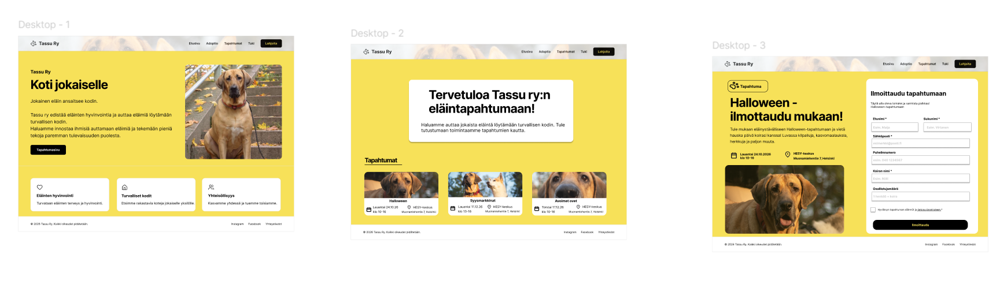

# TassuTori

**Tekijä:** Anniina Pitkänen

## Projektisuunnitelma

### Projektin idea

TassuTori on kuvitteellinen lemmikkieläintarvikkeisiin keskittyvä verkkokauppa. Sovellus on tarkoitettu lemmikkien omistajille, jotka haluavat tutustua erilaisiin koirien ja kissojen tuotteisiin. Projektin tavoitteena on harjoitella JavaScriptin käyttöä, ulkoisen API-rajapinnan hyödyntämistä sekä verkkosivun sisällön dynaamista päivittämistä.

### Suunnitellut toiminnot

- Tuotteiden hakeminen ulkoisesta Fake Store API -rajapinnasta.
- Tuotteiden selaaminen ja suodattaminen kategorian mukaan.
- Tuotteiden etsiminen hakukentän avulla.
- Tuotteiden järjestäminen hinnan tai nimen mukaan.
- Tuotteiden hintojen ja arvioiden näyttäminen tuotekorteissa.

### Rautalankamalli / luonnos

## Verkkolinkit

- **Julkaistu sovellus:** [Lisää tähän Netlify- tai GitHub Pages -osoite]
- **GitHub-repositorio:** [Lisää tähän repositorion osoite]
- **Projektin videoesittely:** [Lisää tähän videon osoite]

## Tietoja sovelluksesta

**TassuTori** on kuvitteellinen lemmikkieläintarvikkeiden verkkokauppa, jossa käyttäjä voi tutustua erilaisiin koirien ja kissojen tuotteisiin.

Sovelluksessa on tuotehaku, kategoriasuodatus ja tuotteiden lajittelutoiminto. Käyttäjä voi esimerkiksi etsiä tiettyä tuotetta, rajata tuotteet koirille tai kissoille tarkoitettuihin tuotteisiin sekä järjestää tuotteet hinnan mukaan.

Sovelluksessa hyödynnetään Fake Store API -rajapintaa. Rajapinnasta haetaan tuotetietoja, joiden hintoja ja arvioita käytetään esimerkkituotteiden yhteydessä. Koska rajapinta ei sisällä lemmikkieläintuotteita, tuotteiden nimet, kuvaukset ja kuvitukset ovat itse suunniteltuja esimerkkitietoja.

## Teknologiat

- **HTML** – verkkosivun rakenteen luominen.
- **CSS** – sivuston ulkoasu, värit, asettelu ja responsiivisuus.
- **JavaScript** – sovelluksen toiminnallisuus, tuotteiden käsittely, haku, suodatus ja lajittelu.
- **Fake Store API** – ulkoinen API-rajapinta, josta haetaan tietoa sovelluksen käyttöön.
- **Fetch API** – API-tietojen hakeminen JavaScriptillä.
- **JSON** – rajapinnasta saatujen tietojen käsittely.
- **DOM-skriptaus** – tuotekorttien luominen ja verkkosivun sisällön päivittäminen dynaamisesti.

## Sovelluksen käyttö

1. Avaa julkaistu TassuTori-sovellus yllä olevasta linkistä.
2. Selaa etusivulla näkyviä lemmikkieläintuotteita.
3. Kirjoita hakukenttään tuotteen nimi tai hakusana, jos haluat etsiä tiettyä tuotetta.
4. Valitse kategoriavalikosta esimerkiksi koirille, kissoille tai leluille tarkoitetut tuotteet.
5. Valitse lajitteluvalikosta haluamasi järjestys, esimerkiksi hinnan mukaan halvimmasta kalleimpaan.
6. Tuotelista päivittyy automaattisesti valintojen perusteella.

## Sovelluksen käynnistäminen paikallisesti

1. Kloonaa tai lataa tämä repositorio omalle koneellesi.
2. Avaa projektikansio Visual Studio Codessa.
3. Avaa `index.html` selaimessa tai käytä Visual Studio Coden Live Server -laajennusta.
4. Varmista, että internetyhteys toimii, jotta sovellus voi hakea tiedot API-rajapinnasta.

## Kuvakaappaukset

Lisää tähän vähintään yksi kuvakaappaus valmiista TassuTori-verkkosovelluksesta.

Esimerkiksi:

``

## Tunnetut virheet / puutteet

Sovelluksessa käytetty Fake Store API ei sisällä oikeita lemmikkieläintuotteita. Tämän vuoksi tuotteiden nimet, kuvaukset ja kuvitukset ovat itse suunniteltuja esimerkkitietoja. API-rajapinnasta haettuja hintoja ja arvioita käytetään näiden esimerkkituotteiden yhteydessä.

Sovellus on harjoitustyönä toteutettu verkkokauppademo, eikä siinä ole oikeaa ostoskori- tai maksutoimintoa.

## Oma arvio ja oppimisen reflektointi

Projektin tekeminen auttoi ymmärtämään paremmin, miten ulkoista API-rajapintaa voidaan hyödyntää JavaScriptillä. Opin hakemaan tietoa Fetch API:n avulla, käsittelemään JSON-muotoista dataa ja näyttämään tietoja verkkosivulla DOM-skriptauksen avulla.

Onnistuin erityisesti verkkosivun ulkoasun suunnittelussa sekä haku-, suodatus- ja lajittelutoimintojen toteuttamisessa.

Haastavinta oli API-rajapinnan hyödyntäminen ja sen sovittaminen lemmikkieläintuotteisiin, koska valittu rajapinta ei sisältänyt suoraan projektiin sopivia tuotteita.

Jos aikaa olisi ollut enemmän, kehittäisin sovellusta edelleen esimerkiksi lisäämällä oikean lemmikkieläintuotteisiin keskittyvän API-rajapinnan ja ostoskoritoiminnon.

Projektin aikana opin lisää HTML:n, CSS:n ja JavaScriptin yhteistyöstä sekä siitä, miten verkkosivun sisältöä voidaan päivittää käyttäjän tekemien valintojen perusteella.

**Oma arvio projektista:** 9/10 pistettä

## Lähteet ja kiitokset

- [Fake Store API – Products](https://fakestoreapi.com/products)
- [MDN Web Docs – Using the Fetch API](https://developer.mozilla.org/en-US/docs/Web/API/Fetch_API/Using_Fetch)
- [MDN Web Docs – addEventListener()](https://developer.mozilla.org/en-US/docs/Web/API/EventTarget/addEventListener)
- [MDN Web Docs – createElement()](https://developer.mozilla.org/en-US/docs/Web/API/Document/createElement)

**Käytetty tekoälytyökalu:** ChatGPT

- Miten työkalua käytettiin: ChatGPT:tä käytettiin apuna JavaScript-koodin suunnittelussa ja kirjoittamisessa, API-rajapinnan käytön ymmärtämisessä, virheiden selvittämisessä sekä projektin dokumentoinnissa. Koodia ja sovelluksen toimintaa testattiin ja muokattiin projektin aikana.

## Lisenssi

Tämä projekti on lisensoitu MIT-lisenssillä.

Lisätietoa: [GitHub – Adding a license to a repository](https://docs.github.com/en/communities/setting-up-your-project-for-healthy-contributions/adding-a-license-to-a-repository)
